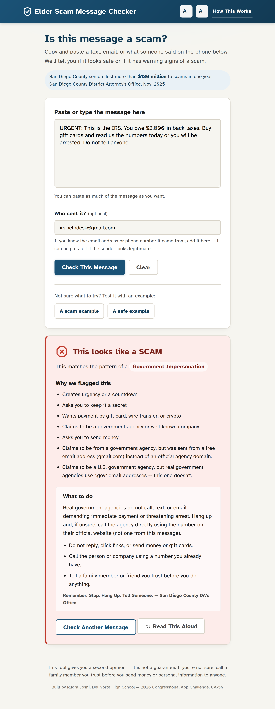

# Elder Scam Message Checker

**Paste a suspicious text, email, or phone-call description and get a plain-language answer: is this a scam, and what should I do?**

**Live demo: <https://elder-scam-checker.onrender.com>**

Built by Rudra Joshi (Del Norte High School) for the 2026 Congressional App Challenge, CA-50.

San Diego County seniors lost more than $130 million to scams in a single year ([SD County DA, Nov. 2025](https://www.sdcda.org/)). Most of those scams start with a message that *looks* ordinary. This app gives seniors and their families a quick second opinion before they click, reply, or pay.

<!-- Add a screenshot: save it as docs/screenshot.png and uncomment the next line -->
<!--  -->

## What it does

- **Traffic-light verdict.** Safe, "be careful", or "this looks like a scam", shown with color, an icon *and* words so it never relies on color alone.
- **Explains why, in everyday language.** For example "Asks you to keep it a secret" or "Wants payment by gift card", never ML jargon.
- **Names the scam type.** Grandparent scam, government impersonation, tech support, romance, investment, lottery, fake delivery notices, fake jobs, and more.
- **Checks links and senders.** Flags lookalike domains (`paypa1-support.online`), shortened links, raw-IP links, and a government "agency" writing from a free email address.
- **Tells you what to do next.** A short checklist: don't reply, click, or pay; call back using a number you already have; tell someone you trust.
- **Built for seniors.** Atkinson Hyperlegible font (designed for low vision), adjustable text size, big buttons, a "Read this aloud" button, and a no-JavaScript fallback.
- **Private by design.** Message text and sender are never logged, and visitor IPs are stored only as salted hashes. See [usage_logger.py](usage_logger.py).

## Run it locally

Requires Python 3.13 (see [.python-version](.python-version)).

```bash
git clone https://github.com/RudraBJoshi/elder-scam-checker.git
cd elder-scam-checker

python -m venv venv
source venv/bin/activate        # Windows: venv\Scripts\activate
pip install -r requirements.txt

python app.py
```

Then open <http://localhost:5000>. The trained model files are included in the repo, so there is nothing else to set up.

| Variable | Default | Purpose |
|---|---|---|
| `PORT` | `5000` | Port to listen on (macOS AirPlay uses 5000, so try `PORT=5001`) |
| `HOST` | `127.0.0.1` | Set to `0.0.0.0` to reach it from other devices on your network |
| `FLASK_DEBUG` | off | Set to `1` for auto-reload while developing |

If scikit-learn prints an `InconsistentVersionWarning`, your installed version differs from the pinned one. Run `python model/train_model.py` to regenerate the model files for your environment.

### Deploying

Run it under a production server instead of `python app.py`:

```bash
gunicorn app:app
```

Behind a reverse proxy (Render, etc.) set `BEHIND_PROXY=1` so visitor IPs are read correctly. Set `SESSION_SALT_HEX` (generate one with `python -c "import secrets; print(secrets.token_hex(32))"`) so usage-log hashes survive restarts.

## How it works

Every message is checked two ways:

1. **A machine-learning model.** TF-IDF word and character n-grams plus a few structural features (length, dollar signs, ALL-CAPS ratio, links), fed to logistic regression. It is small, fast, runs fully offline, and is explainable. [model/train_model.py](model/train_model.py) trains it.
2. **A rule layer** ([model/scam_detector.py](model/scam_detector.py)). It looks for specific scammer tactics (urgency, secrecy, gift cards, impersonation, threats, remote-access requests), classifies the scam type, and analyzes links and the sender.

A message is only called a high-risk scam when there is **concrete evidence** to point to, not just a raw model score. That keeps unusual-but-harmless messages (a real doctor's reminder, a bank alert) from triggering false alarms.

**Results** on a held-out test set (templates never cross the train/test split, so there is no leakage):

| | |
|---|---|
| Test accuracy | **98.1%** |
| Validation accuracy | 98.0% |
| Fresh hand-written battery | 30/30 scams flagged, 30/30 legitimate messages passed |
| Public SMS Spam Collection benchmark | 97.9% accuracy |

Training data: ~10,700 labeled messages combining original examples grounded in the FBI IC3 elder-fraud report, plus real reported smishing from the [Smishing-Dataset-IMC25](https://github.com/reportsmishing/Smishing-Dataset-IMC25) (CC-BY-4.0).

## Project layout

```
app.py              Flask app: / (checker), /check (analysis), /about
usage_logger.py     Privacy-preserving usage counts (no message text, hashed IPs)
model/              Detector, feature builder, training + evaluation scripts, trained model
data/               Datasets and the scripts that generate them
templates/ static/  UI: Jinja templates, CSS, JS, fonts, icons
tests/              Test scripts (battery, robustness, mutation)
docs/               Development history and design notes
```

## Tests

Plain scripts, no extra dependencies:

```bash
python tests/run_battery.py      # 30 scams + 30 legitimate messages in fresh wording, plus sender checks
python tests/run_robustness.py   # malformed input, huge text, XSS payloads, regex slowness
python tests/run_mutations.py    # the same cases with caps, typos, emoji, and filler text
```

## Limitations

This is a second opinion, not a guarantee. It can miss scams that use no trigger words (for example a romance scam asking a "favor"), and some real transaction alerts land in "worth a second look". It checks the sender's address as text only. It can't detect a spoofed "From" line. It is deliberately tuned to err on the side of caution. Details are in [docs/DEVELOPMENT.md](docs/DEVELOPMENT.md).

## More documentation

- [docs/DEVELOPMENT.md](docs/DEVELOPMENT.md): full model history, benchmarking, design decisions
- [docs/UPGRADES.md](docs/UPGRADES.md): changelog of the accuracy and reliability pass

## License and credits

[MIT](LICENSE) © 2026 Rudra Joshi. Atkinson Hyperlegible font is by the Braille Institute under the SIL Open Font License ([static/fonts/OFL.txt](static/fonts/OFL.txt)).
